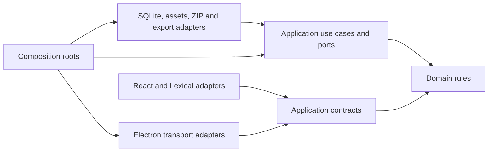
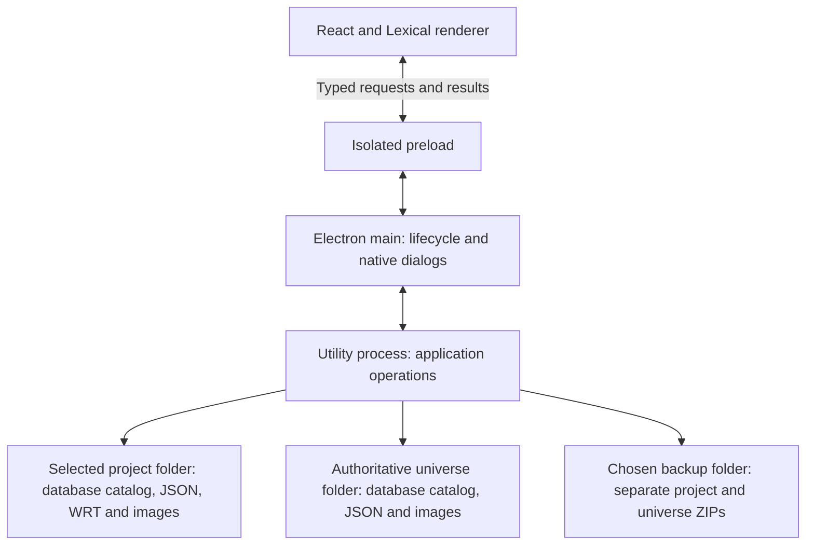
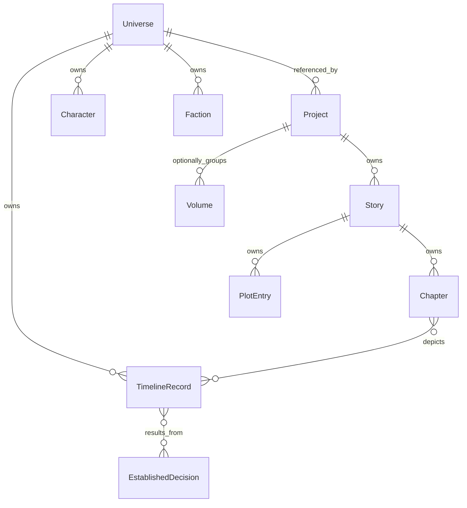

# Architecture Spine — WritingTool

## Design Paradigm

Clean Architecture. Domain owns writing rules; application owns use cases and ports; presentation and infrastructure implement the outer adapters. Composition roots wire adapters. Runtime processes are hosts, not dependency layers.



## Invariants & Rules

### AD-1 — Electron desktop host [ADOPTED]

- **Binds:** Desktop host, presentation and packaging.
- **Prevents:** Features selecting incompatible desktop runtimes.
- **Rule:** Deliver a local Electron desktop application with its runtime bundled in separate platform builds. All first-release capabilities operate locally.

### AD-2 — SQLite first; PostgreSQL later [ADOPTED]

- **Binds:** Persistence, revisions, database export and recovery.
- **Prevents:** Requiring a PostgreSQL service in the first implementation.
- **Rule:** Initially implement SQLite through application-owned persistence ports. PostgreSQL is deferred. Provider-specific migrations, backups, export and transaction behavior belong to infrastructure; another provider must satisfy the same application contracts.

### AD-3 — Inward dependencies throughout [ADOPTED]

- **Binds:** All code.
- **Prevents:** Business rules depending on UI, storage or archive frameworks.
- **Rule:** Domain imports no Electron, React, Lexical, database, filesystem or archive APIs. Application depends on domain and defines infrastructure ports. Adapters depend inward. Editor conversion, transport validation and storage mapping occur outside the inner layers. Select open-source tools; required first-release functionality must work locally.

### AD-4 — Managed external images [ADOPTED]

- **Binds:** Image import, character/faction assets, persistence and recovery.
- **Prevents:** Image BLOBs in SQLite or dependence on original external files.
- **Rule:** Copy imported images into the owning unit's managed image folder. SQLite stores references relative to that unit's storage root, never image bytes or a dependency on the original import path. Saved versions referenced by current work or retained revisions remain available. Every backup includes its required images.

### AD-5 — Independent complete ZIP backups [ADOPTED]

- **Binds:** Backup and disaster recovery.
- **Prevents:** Restore dependencies on the source database or another ZIP.
- **Rule:** Every completed backup is a separate ZIP containing a consistent saved database state, retained revisions and all required content/images. Store shared content once within that archive; duplication across separate archives is permitted. Backup triggers are manual, configurable schedule and normal application close. Destination selection and unavailable-destination prompts follow FR-25/26, including application-root then user-data fallback on canceled close-time selection and next-launch notification.

### AD-6 — Distinct project and universe units [ADOPTED]

- **Binds:** Ownership, grouping, backup and restoration scope.
- **Prevents:** Treating projects, universes and stories as the same entity.
- **Rule:** A project associates with a separately owned universe and can contain multiple stories, optionally grouped into volumes. Volume, story and chapter counts are unrestricted; word targets are informational. Universe data is shared only within that universe. Project ZIPs include the project's complete state and a backup of its universe. Standalone universe ZIPs require no project. Project grouping and manuscript/plot data do not become universe-owned.

### AD-7 — Reconcile project recovery against the live universe [ADOPTED]

- **Binds:** Project restoration and conflict resolution.
- **Prevents:** Downgrading or automatically forking a shared universe during project restore.
- **Rule:** Preserve a pre-restoration revision marked Replaced. Restore the older project against the newest authoritative universe state; present conflicts for manual resolution. Do not silently overwrite shared records or activate an unresolved restored state. Update the restored project after resolution, then create a new project ZIP with its reconciled universe snapshot. Failure to create that ZIP must remain visible and retryable, not reported as completed backup.

### AD-8 — One authoritative universe [ADOPTED]

- **Binds:** All universe access, mutation and restoration.
- **Prevents:** Competing live project-local universe copies.
- **Rule:** Every associated project refers to the same authoritative universe. Backup copies are recovery snapshots, not live authorities. Universe changes use the authority's application use cases; any explicit manual resolution that changes universe data changes that authority. If authority is missing, establish one through recovery before activating the project. Universe recovery must reconcile against an existing authority rather than create a second live copy with the same identity.

### AD-9 — User-selected live folders [ADOPTED]

- **Binds:** Create/open, storage roots and relocation.
- **Prevents:** Hard-coded writing data in installation or mandatory user-data directories.
- **Rule:** Let Jo choose live project and universe folders independently of backup destinations. Asset references remain relative to their owning root. Moving a folder requires resolving its identity/location; it must not silently create another authoritative universe.

- **Root resolution amendment:** Store each project/universe base-folder location once as a separate database root record. Object locations carry root identity plus relative path. After validating a moved root’s UUID, update only that base record; no per-object rows/files/relationships are rewritten. Projects sharing a universe resolve the same universe-root mapping. The database itself stays in its dedicated subfolder within that root; bootstrap/atomic root update details remain the shared technical contract.

### AD-10 — ID catalog database and category-owned object files [AMENDED BY JO]

- **Binds:** Storage topology, object locations, relationships and cross-unit references.
- **Rule:** Each project/universe owns a SQLite catalog in its own dedicated database folder within its selected data root. Actual structured object data/settings live in category-owned `<object-id>.json` files; writing lives in plain-text `<chapter-id>.wrt` files. The catalog stores IDs, filenames, related/linked object relationships and root-relative locations; base folders are separate single root records rather than absolute prefixes repeated in object rows. Payload files supply content and the database supplies the maintained correlation/location/relationship catalog; neither is assumed dispensable. Paths are relocatable locations, not identities. Cross-universe references validate owning identity and every authoritative write coordinates file and catalog publication through one application writer. TECH-01/02/04/05/09/11 must publish/verify schemas, migrations, crash/restart and consistent capture before implementation. Every complete ZIP includes the catalog and required JSON/WRT/images/history/category content.

### AD-11 — TypeScript and React [ADOPTED]

- **Binds:** Application language and renderer implementation.
- **Prevents:** Incompatible UI implementations or React entering inner layers.
- **Rule:** Write application code in TypeScript; use React in presentation. Start from the official Electron Forge Webpack + TypeScript template with React added; adapt its directory/import boundaries to AD-3/18.

### AD-12 — Lexical editor adapter [ADOPTED]

- **Binds:** Manuscript editing.
- **Prevents:** Different editor engines or storage depending on editor runtime objects.
- **Rule:** Use Lexical through a React presentation adapter. Preserve bold, italics, paragraph indentation, headings and scene breaks across editing, save/reopen and revision recovery. Editor undo history does not replace automatic revisions.

### AD-13 — Plain-text WRT writing and JSON metadata contract [AMENDED BY JO]

- **Binds:** Editor mapping, persistence, revisions and manuscript exports.
- **Rule:** Chapter writing is plain text in `<chapter-id>.wrt`, with chapter/object metadata in ID-named JSON files. The database catalogs identities, file locations and relationships. The previous persisted JSON manuscript-payload choice is superseded. React/Lexical remains the editor adapter; revisions and DOCX/PDF/MD/TXT exporters must use the same application-owned text/metadata contract. DEC-36 is settled: chapter JSON stores the bold/italic/indent/heading/scene-break metadata for its matching plain-text WRT, both named with the chapter ID. The editor, revisions, restoration, backups and exports consume matched pairs; required catalog and both file states are durably coordinated before success. Do not put markup/JSON in WRT, silently mix text/metadata versions or discard FR-1 formatting. TECH-01 defines versions/encoding/migration/validation. Unsupported schemas must not be rewritten blindly.

### AD-14 — Complete revisions with shared immutable content [ADOPTED]

- **Binds:** Snapshot capture, restore, backup and garbage collection.
- **Prevents:** Replay-dependent revision chains or duplicate unchanged content.
- **Rule:** Each revision is a complete logical state indexed by a complete manifest referencing immutable saved content. It restores without replaying earlier revisions. Project revisions cover manuscript/plots and the saved universe-owned character/event content needed for the revision, through a pinned historical universe checkpoint; this is historical state, not a live replica. Reuse unchanged content within its owning store; preserve every object/record required by current content or a retained revision, including cross-unit checkpoint/asset dependencies. Project ZIPs include that historical dependency closure as well as the current universe snapshot. Capture at a configurable interval (default 10 minutes), on normal close and before restoration. Before capture of current work, backup or normal close, synchronize pending manuscript edits through application use cases and obtain durable acknowledgment; never snapshot only an older autosaved document while claiming to capture current work. Before either item or whole-project restoration, capture current state in a revision marked Replaced. Do not apply restoration if pending edits or that protective snapshot cannot be persisted. Restore selected items to saved state and leave unselected records unchanged; any conflict with the authoritative universe requires manual reconciliation under AD-7/8.

### AD-15 — Time-only cleanup and ten protected backups [ADOPTED]

- **Binds:** Revision/archive retention, deletion and settings.
- **Prevents:** Size-based expiry or one busy unit displacing another's backups.
- **Rule:** Configurable retention defaults to 30 elapsed days for revisions and completed backup ZIPs. Size never determines expiry. Remove oldest eligible entries first. For each project and each standalone universe independently, protect the ten newest successfully completed, valid backup ZIPs regardless of age; if fewer exist, protect all. Embedded universe snapshots do not replace standalone universe backups. This protection also applies to manual archive deletion. Retain referenced revision/current-content dependencies; no ten-revision minimum is specified. Deleting an archive never deletes live-store assets. Include retention settings in JSON export/import.

### AD-16 — Explicit chapter-date mutation scope [ADOPTED]

- **Binds:** Chapter dates and linked timeline mutation.
- **Prevents:** Unwanted shifts, invented offsets and flashback movement.
- **Rule:** First assigning or clearing a start date changes only that field. Moving an existing start offers linked updates enabled by default and switchable off. When enabled, use the elapsed-day start-date delta to shift an existing end and only selected main events; an absent end remains absent. When disabled, alter only explicitly edited fields. An end-date-only edit alters only end. Unselected events keep current date/content; chapter-driven operations never change flashback historical dates. Restoration uses selected saved states, not movement offsets, subject to shared-universe conflict resolution.

### AD-17 — Supported installed desktop targets [ADOPTED]

- **Binds:** Packaging and platform checks.
- **Prevents:** Promising legacy OS support incompatible with Electron.
- **Rule:** Normal installation with desktop/application-menu integration under approved DEC-09: Windows 10/11 x64 .exe; macOS 13+ Intel x64/Apple Silicon ARM64 .dmg; Ubuntu 22.04+/Debian 12+ x64 .deb. Individually verify Pop!_OS, Zorin and Mint. Bundle the application and LibreOffice runtimes; Windows/Linux ARM are deferred. Verify actual compatibility before acceptance. Keep live writing folders separate from installation. Use maintained runtime versions compatible with these floors.

### AD-18 — Dedicated background application boundary [ADOPTED]

- **Binds:** Runtime hosting, transport and writes.
- **Prevents:** UI code issuing raw database/filesystem operations or heavy work blocking lifecycle handling.
- **Rule:** React/Lexical renderer presents and edits, with context isolation and sandbox enabled and Node integration disabled. Preload exposes bounded typed commands/queries. Electron main handles windows, native dialogs and lifecycle, and routes messages to an internal Electron utility process hosting application use cases and infrastructure. All authoritative writes pass through those use cases, serialized by one writer coordinator for each project/universe identity across every open session; another host cannot independently write that same unit. Validate messages at transport adapters; no generic SQL/filesystem access through the bridge. Load packaged application content in the privileged window; remote navigation and imported manuscript/archive content cannot acquire that privilege. Import adapters validate schemas and confine extracted files/references to managed roots. Coordinate normal shutdown so pending work is saved, closing revisions and backups finish, and failures receive the agreed recovery handling before close completes.

## Consistency Conventions

| Concern | Contract |
| --- | --- |
| Identity | Project, universe and record identity survives relocation and backup. Cross-unit references carry owning universe identity; paths are locations, not identities. Final identifier wire format must be shared before persistence/IPC work starts. |
| Fictional chronology | One universe-owned date-only chronology; all date conversion goes through its calendar rules. Calendar edits preserve elapsed positions/order/intervals and recalculate displayed dates. The common persisted coordinate/epoch contract must be fixed before calendar/persistence work. |
| Real time | Snapshot/archive age uses real elapsed time, independent of fictional dates; clocks and timestamps use a common documented contract before retention implementation. |
| Event ownership | Universe owns canonical timeline records; project/story/chapter views link to those records. Chapter depiction links distinguish main events and flashbacks. Standalone universe records require no project; loss of project data must not make its universe unreadable. |
| Derived state | Decision resolution derives from remaining decision/resulting-event links (many-to-many). Plot numbering derives from each story's undated-first/dated-chronological order. Current faction/history follow one faction at a time. Draft completeness is separate from save validity. |
| Visibility and errors | Report persistence, reconciliation and backup outcomes independently. Never label a failed or partial archive successful; unavailable live data never triggers silent replacement. |
| Settings and save | Autosave defaults to 5 minutes, separately configurable from 10-minute revisions. Preserve theme, intervals, backup destination/schedule and retention through settings JSON import/export. [ASSUMPTION] Scheduled backup default is 10 minutes, inherited from the PRD; confirm before scheduling implementation. |

## Stack

Cold-start candidates, verified against official release pages on 2026-10-10. These exact pins are engineering seed, not evidence that integration has run; scaffold/editor/native packaging compatibility must pass before adoption into a lockfile.

| Name | Version |
| --- | --- |
| [Electron](https://releases.electronjs.org/release/v44.7.0) | 44.7.0 |
| [TypeScript compiler API baseline](https://github.com/microsoft/TypeScript/releases) | 6.0.3 |
| [React / React DOM](https://github.com/react/react/releases/tag/v19.3.0) | 19.3.0 |
| [Lexical / matching Lexical packages](https://github.com/facebook/lexical/releases/tag/v0.52.0) | 0.52.0 |
| [Electron Forge / matching Forge template/plugins](https://github.com/electron/forge/releases/tag/v8.0.1) | 8.0.1 |

SQLite is the adopted engine. Its adapter and actually bundled engine version must be chosen together; PostgreSQL, ZIP libraries and additional UI libraries are not selected here. The later DEC-06 amendment selects bundled LibreOffice for DOCX/PDF and application-owned TypeScript serializers for MD/TXT.

## Structural Seed





Volume membership cardinality/ordering is deliberately outside this seed; counts remain open-ended.

```text
src/
  domain/          writing, chronology and shared-record rules
  application/     use cases, ports and shared contracts
  presentation/    React views and Lexical mapping
  infrastructure/  SQLite catalog, JSON/WRT files, managed assets, revisions and export adapters
  desktop/         Electron main, preload, utility host and composition roots
```

Installation and development builds use platform-specific packaging. Production operates on one machine with local stores and selected backup destinations, including external drives. No hosted service, synchronization or collaborative deployment is in first-release scope. OS user-data may hold application settings/location metadata and the agreed backup fallback, while writing content remains in selected roots. Bootstrap and native-library packaging are verified in installed builds, not just development mode. Signing, update delivery and release automation are deferred for this personal release.

## Capability → Architecture Map

| PRD capability | Owner | Governing decisions |
| --- | --- | --- |
| Manuscript, chapters, export, targets: FR-1/27/42/47/49 | Project/story use cases, editor and export/persistence adapters | AD-2/6/11–13/16 |
| Revision recovery, retention, backups: FR-2–4/18–26 | Recovery use cases, manifests, assets and archive adapters | AD-4–10/14–15/18 |
| Event movement, calendar: FR-5–14 | Universe chronology and chapter movement use cases | AD-6/8/10/16; chronology convention |
| Character creation/viewer, traits, factions, background: FR-15–17/36–39/48 | Universe domain and presentation adapters | AD-3/4/6/8/10; derived-state convention |
| Settings/theme/autosave: FR-28–30/43 | Settings/save use cases and desktop/presentation adapters | AD-3/15/17/18; settings convention |
| Decisions and plots: FR-31–34 | Universe decision graph, story plots and query adapters | AD-6/8/10; derived-state convention |
| Standalone timeline and linked context: FR-35/40–41/44–46 | Universe record queries, selection context and views | AD-6/8/10/16/18 |

All PRD capabilities remain first-release requirements. Architecture amendments replace the old size-based retention policy and add independent project/universe backup scope and optional volumes; see [reconciliation](RECONCILIATION.md).

## Deferred

These are preconditions for the affected implementation, not permission for separate builders to choose different contracts.

| Decision/detail | Owner and revisit gate |
| --- | --- |
| Common identity, DTO/error, document and backup-manifest schemas | Architecture/spec: publish one versioned contract for all adapters before persistence, IPC or recovery implementation. No independent local formats. |
| Cross-database and asset publication protocol, durable operation identity/recovery, consistent backup cut, writer lease/concurrent-open handling, pending-edit acknowledgments and close/retry behavior | Architecture/spec: one application coordinator owns the operation contract, including serialization across sessions and recovery after losing the background host. Prove crash/restart and partial-failure consistency before linked mutation or backup implementation. SQLite cross-file guarantees are not assumed. |
| Missing-authority recovery selection, equal/divergent universe versions, conflict definitions and cancellation, universe changes during reconciliation | Jo/architecture: settle workflow before recovery implementation; no automatic conflict winner, overwrite or authority fork. A new ZIP is a post-resolution outcome. |
| Universe integrity when project-linked records are removed/restored | Architecture/spec: fix reference/history preservation and partial-item recovery scope before deletion/restore implementation. Universe must remain independently usable. |
| Complete revision manifest/object identity, image-version immutability, cleanup roots and archive discovery across moved destinations | Architecture/spec: fix one store-wide contract before snapshot/cleanup implementation; prove protected archives and referenced objects survive. |
| SQLite adapter, bundled SQLite version, journaling/migration strategy; PostgreSQL provider | Architecture/build: verify actual embedded/native binding and platform packaging before persistence implementation. PostgreSQL later; never call it a drop-in unverified replacement. |
| Date coordinate/epoch, fictional year bounds and invalid date-range handling | Architecture with Jo: one calendar contract before date persistence; calendar-edit position preservation is binding. |
| Volume membership/order, plot equal-date/undated ties, simultaneous explicit chapter start/end edits | Jo/UX/spec before relevant grouping/ordering/date-edit stories; do not impose fixed counts or override confirmed chronology/mutation scope. |
| Local DOCX/PDF/MD/TXT libraries, export presentation, character prompts and date display | UX/build with Jo before export/creator/calendar UI stories; open-source tools, all agreed formats/fields and waiver behavior remain required. |
| Exact installer formats, Linux baseline, x64/ARM coverage and CI/platform test access | Architecture/build with Jo before packaging; test Windows 10+, macOS 13+, and requested Linux families. Distribution/version breadth is a goal to validate. |
| Integration of exact cold-start pins and live starter defaults | Build before lockfile adoption: verify isolated renderer/preload, utility process bundling, Lexical round-trip and installed SQLite/native assets. Candidate pins may change with recorded evidence; technology choices and layer contracts remain binding. |
| Performance budgets and representative manuscript/event/image corpus | Jo/build before performance acceptance: initial baseline roughly ten stories/~100 chapters and two volumes; grow beyond it. No word/count caps; no invented latency claims. |
| Backup schedule default, setting validation, cancellation outside application close | Jo/UX before scheduler/error-handling implementation; retain configurable intervals and agreed close fallback. |
| Public distribution, signing, automatic software updates, cloud/collaboration | Revisit if personal desktop scope changes. Optional chapter-date updates do not imply software update requirements. |

## Storage amendment — accepted during final story validation

Object content, including character data, timeline information, project metadata, settings and other non-manuscript structured data, is saved in JSON-format `.json` files inside the appropriate category folders. Writing content, including chapter manuscripts, is saved as plain text in `.wrt` files. Each saved object’s filename stem is its permanent object ID: `<object-id>.json` for structured data and `<chapter-id>.wrt` for chapter writing. A chapter can have JSON metadata and a plain-text manuscript with the same ID stem and different extensions. Human-readable titles/names are editable data, not file identities.

The database catalogs object IDs, filenames, locations, links and relationships. JSON/.wrt files are the source of object content; the database is the maintained identity/location/relationship catalog, not a second independently editable copy of manuscript or character/timeline/settings payloads. This does not imply the relationship database is disposable or automatically reconstructible: it must be saved and backed up with the files. Exact versioned JSON/relationship schemas, encoding, internal filenames for other asset/manifest kinds and catalog repair behavior remain shared technical-contract work. Revision version containers/addresses must retain immutable older files even when their logical object filenames share the same ID; TECH-09 defines that layout.

Existing ownership remains: project files hold project/story/chapter/plot content, universe files hold universe/timeline/character/faction/event/decision content. Settings are JSON in their accepted owning scope; the settings object ID/location schema does not silently change application-wide settings into per-project settings. Each project/universe database stays in its own dedicated database folder under that unit’s root. Each category’s content stays in its category folder. Complete ZIPs include consistent database catalogs, JSON/.wrt content, images, retained history and required reference closure; neither the catalog nor the files alone substitute for complete recovery.

Application writes must coordinate content-file publication with ID/location/relationship catalog updates before durable acknowledgment, revision/backup completion or recovery activation. The crash/restart/serialization/consistent-capture protocol remains TECH-02–05/09/11, not presumed atomic because SQLite is used. DEC-33’s content representation and catalog responsibility are now settled by Jo’s explicit choice. This supersedes the earlier AD-13 requirement to persist the manuscript itself as structured JSON. Rich-formatting requirements remain agreed unless Jo changes them; DEC-36 must resolve how bold/italics/indents/headings/scene breaks are represented alongside plain-text .wrt writing. Do not silently put JSON, HTML, Markdown markers or rich-text payloads inside `.wrt`, or silently remove formatting requirements.

## Base-folder relocation amendment

For each independently located project or universe data root, the database stores its base-folder location once in a separate root-location record. Object locations store the owning root identity and a path relative to that base, never a repeated absolute prefix. Resolve an object as its owning base folder plus its relative path, including category JSON files, WRT writing, managed assets and the database subfolder as applicable.

When Jo locates an entire data folder after moving it, validate the same owning UUID and update only that root’s base-folder location. Object IDs, filenames, per-object relative paths, content and relationships remain unchanged; do not rewrite every object row or JSON/WRT file. Same-universe projects resolve the universe through its UUID/root mapping rather than persisting their own repeated absolute universe paths. Projects and universes keep their independent roots, so changing one does not relocate the other.

ZIPs and retained manifests preserve logical root identities and relative paths so recovery at a new location can bind the root once without rewriting each object. No historical absolute base path overrides the confirmed current location. This changes location resolution, not content chronology or live authority. Moving an individual object within a root is a separate explicit location update, not the whole-folder rebind operation. Root discovery/bootstrap and atomic validation/publication of the base record remain in TECH-01/02/04/11; no additional global database or mandatory new registry location is implied.

## Chapter formatting amendment — DEC-36 accepted

Each chapter’s writing is plain text in `chapters/<chapter-id>.wrt`. Its companion `chapters/<chapter-id>.json` holds chapter metadata and the formatting needed to render that text, including bold, italics, paragraph indentation, headings and scene breaks. Both files use the same permanent chapter ID. These paths illustrate the chapter-category relationship; root-relative resolution and the accepted category layout apply. Rich formatting must not be embedded as JSON/HTML/Markdown payload in the WRT text.

Editing and reopening combine the matched text and JSON formatting metadata through the editor adapter. Application edits update formatting anchors/structure with the changed text under one versioned manuscript contract. Saves acknowledge success only when the required text, metadata and database catalog state are durably published as a consistent version. Revisions, Replaced capture, backups, restoration and manuscript export consume the corresponding matched text/metadata versions; restoring one saved chapter must not mix its historical text with live formatting or vice versa. Root relocation preserves the relative paths and paired chapter identity.

If either component is missing, incompatible or belongs to another text version, do not silently apply mismatched formatting, discard source content or claim a complete save/restore/export. Report the condition and use the accepted validation/recovery contract. TECH-01 defines exact metadata fields, text/format association/version validation, paragraph/range anchoring, encoding and migrations; TECH-02/03/09 define crash-safe paired publication/capture and retained version identity. These technical details remain gates, but the choice of JSON formatting metadata alongside plain-text WRT is settled (DEC-36).

## Chapter range amendment — DEC-01

If both chapter dates are present and the end is earlier than the start, automatically set the end equal to the start before committing the date change. Use the start as the correction reference, including when both values are supplied together. For example, start day 20/end day 10 becomes start day 20/end day 20. If the range is valid or either date is absent, retain normal independent optional-date behavior; do not invent a missing bound or preserve an old duration by shifting dates.

This is the specific invalid-range exception to otherwise independent start/end fields. It changes only the chapter’s end value needed to equalize an inverted pair, never linked main-event/flashback dates/content, manuscript text or ownership. Persist/display the resulting equal values and use the saved start for chapter ordering. Invalid date syntax/calendar bounds remain the common validation contract; equalization is not a rule for manufacturing a valid date from invalid input. Cancel/failure leaves previously committed dates unchanged under the shared save contract. Chapter-only restore/recovery applies this agreed range-validation contract without changing linked events.

This current rule and the prior chapter/event-isolation contracts supersede AD-16 historical automatic movement assumptions.

## Chapter tie ordering — DEC-16

Chapters sharing the same start date are ordered by their saved creation order within that date. Chapters with different start dates remain chronological. Chapters with no start date remain first in creation order; an end-only chapter has no substitute start sorting key. Date edits, renames, saves, reopen and calendar display changes do not reset chapter creation order. This is the chapter-list tie rule, not manual timeline/plot within-date ordering.

## Pending manuscript navigation — DEC-15

Before switching chapters/projects, opening the event editor or otherwise leaving pending manuscript writing, automatically save the pending text and its companion JSON formatting/metadata through the normal coordinated application save contract. Do not wait for the periodic autosave timer. Continue navigation only after durable acknowledgment covers the required text/metadata/catalog version; edits made after the submitted version must not be falsely acknowledged or discarded.

If automatic saving fails, show a clear warning that the writing has not been saved, keep the pending edits available in the current editor and leave navigation pending. Offer retry or cancel navigation; never silently discard work or report a failed save as successful. Canceling navigation keeps the current editor and writing. Retrying reuses the accepted save/publication contract. This navigation-triggered save does not change the independently configured periodic autosave, revision or backup intervals and does not itself claim a revision/backup was completed. Normal-close capture retains its separate complete revision/backup requirements.

## Autosave scheduling amendment — DEC-17

Periodic autosave starts its timer when a project opens and restarts that timer when its configured interval changes. The default interval remains 5 minutes. At each due interval, save pending changes through the same coordinated WRT/companion-JSON/catalog save contract; unchanged content needs no redundant write. A navigation-triggered save remains immediate under DEC-15 rather than waiting for this timer.

After system sleep, if an autosave is overdue and changes are pending, run one overdue save rather than replaying every missed interval. Autosaves must not overlap or create competing writers with manual/navigation saves; the common writer/version contract preserves newer edits and prevents stale saves from overwriting newer content. Low-level timer/serialization implementation remains in the shared contracts.

If autosave fails, show a warning that current changes were not saved, retain pending edits and the last valid committed state, retry at the next configured interval and provide Retry now. Retry uses the same non-overlapping save contract. Acknowledgment marks only its actual matched text/metadata version saved; later edits stay pending. Autosave does not change revision or backup intervals or claim that either completed. Revision/backup schedules still have their separately tracked DEC-31/34 rules.

## Revision timing amendment — DEC-31

Revision scheduling uses an independent configurable interval, default 10 minutes. Start its timer when a project opens and restart it when the revision interval changes. After system sleep, perform one overdue revision capture rather than replaying every missed interval. Revision captures must not overlap; writer/capture coordination also keeps them consistent with autosave, navigation saves and backups.

Each attempt first durably saves required pending writing, including matching WRT text, companion JSON formatting and catalog state, then captures a complete revision with its required historical dependency closure. A failed prerequisite save or incomplete capture never becomes a completed revision. On failure warn, preserve current work and existing completed revisions, retry at the next revision interval and provide Retry now. Captures/retries reuse the same complete-manifest/publication contract. These timing choices do not change periodic autosave or backup intervals, and normal-close/pre-restoration revisions still run at their explicit triggers.

## Scheduled backup units/cadence amendment — DEC-34

Scheduled backups target each open project and each universe opened independently as a standalone universe. A universe merely loaded as a project dependency does not acquire an additional standalone backup job; its recovery content remains required inside the project ZIP. An explicitly opened standalone universe is backed up independently even if projects also share it. Jobs are keyed by owning project/universe identity rather than repeated views of the same open unit.

Backup timing has an independent configurable 10-minute default, using the accepted revision-style rules: start when an eligible unit opens, restart when its backup interval changes, run one overdue attempt after sleep rather than replaying missed intervals, and prevent overlapping captures through the shared writer/backup coordination contract. Each attempt uses the complete ZIP pipeline and durably saves required pending writing first. Changing backup timing does not change autosave/revision intervals.

On failure show a warning, preserve valid prior archives/current work, offer Retry now and retry at the next backup interval. Only complete validated durably published ZIPs count as successful. For an unavailable destination, show one alternative-folder selection prompt at a time rather than a stack of repeated prompts. Additional due attempts do not create duplicate prompts or a burst of replayed missed backups; their retry/execution uses the same serialized job contract. Canceling alternate-folder selection skips that attempt, marks it incomplete, preserves the configured destination and later schedule, and leaves retry available. This outside-close path does not invoke normal-close fallback.

## Backup filename format amendment — DEC-35

Completed project ZIP filenames use `<ProjectName>_<UniverseName>_<YYYY-MM-DD>_<HH-mm-ss>.zip`. Completed standalone-universe ZIP filenames use `<UniverseName>_<YYYY-MM-DD>_<HH-mm-ss>.zip`. The timestamp is the real local date/time at the start of that backup’s capture, using a 24-hour clock and seconds; it is not a fictional date or the later completion time.

A complete project archive contains all its volumes, so its filename identifies the project and universe rather than listing individual volume names. No new volume-only backup scope is introduced. Apply the same template to manual, scheduled, normal-close/fallback and post-reconciliation project archives, using the actual names at capture.

Replace characters that the target filesystem cannot accept in filenames with safe characters; exact normalization/replacement and reserved-name/length handling remain a documented cross-platform filename-encoding detail under TECH-01/PLAN-04. Preserve original display names and owning IDs in the manifest. If the intended completed filename exists, choose `_2`, `_3`, etc. before `.zip` until a free name is reserved without overwriting an existing archive. Concurrent publication must make that name reservation safe under the shared publication contract.

Manifests retain the corresponding real capture/completion timestamps, owning identities and sufficient clock/timezone metadata for consistent accounting; local filename display is not the sole basis of retention/protected-set ordering. Recovery/authority identity remains UUID-based. Changing a project/universe name affects later filenames, not existing archive identity.

## Normal-close failure amendment — DEC-08

If required saving, revision capture or backup fails during normal close, including failure of both application-root and user-data fallback locations, show the failure and keep the application open. Preserve pending edits, successfully saved current state, completed revisions and valid backups; report their outcomes separately rather than rolling them back or calling the whole close successful.

Offer Retry, Choose another backup folder where applicable to a backup/destination failure, and Cancel closing. Retry follows the coordinated operation contract and does not damage already completed output. Cancel closing returns to the workspace with writing retained. Complete normal close only after the required pending saves, complete revision and complete backup succeed. There is no silent discard or forced-close override. This concerns application-managed normal close; abrupt process termination remains the separate crash/restart recovery contract.

## Calendar-format update workflow amendment — DEC-32

After item/project/ZIP restoration, flag affected data when its saved calendar configuration or display format differs from the current authoritative calendar. Preserve the historical calendar association and the pending-update state across reopening; merely viewing the data does not clear the flag. Compare the actual applicable configuration/format under the shared schema contract, not just an unrelated filename or a version number that implies no format difference.

Provide an explicit Update to current calendar action. It recalculates displayed dates from the saved elapsed-day positions using the current authoritative calendar and saves the updated current-data calendar/display metadata. Preserve elapsed positions, chronology, relationships and writing; do not overwrite the authoritative calendar or change linked event positions/content as a side effect of updating a restored chapter’s display. Retained immutable revisions keep their exact historical content/format metadata.

Clear the affected current-data flag only after its update saves successfully. On failure report it, retain the flag and offer retry; do not claim the update completed or discard the restored data. Allow manuscript writing while an update is pending and visibly identify the unresolved calendar-format state. This flag does not waive required authority/reference/schema checks before recovery activation. TECH-01/02/03/09 define exact comparison/metadata/publication/version handling; those technical details do not reopen the accepted user workflow.

## Minimum calendar configuration amendment

The minimum valid year definition is its year number and the number of days in that year. A days-only calendar can be created/saved with those values without defining any months or explicit standalone-day entries. Months, year/element names and the richer year structure are configurable options, not prerequisites for the days-only mode. Do not require at least one month/standalone-day component or invent a default 365-day year.

In days-only mode the entered day count defines the actual year length; an empty optional component list does not mean zero days. When months/standalone components are configured, retain the existing ordered composition, actual-total/target mismatch and repeating-year contracts. Calendar changes affecting populated data still preserve elapsed positions/intervals under FR-7. A universe may still exist before a calendar is configured under Story 1.2.

This settles DEC-13’s minimum structure, optional months and names. Exact numeric range/precision validation for day counts/month lengths and year numbers still needs the accepted DEC-03/DEC-13 shared calendar schema; the earlier proposed validation bundle was not accepted wholesale. Do not silently decide year zero/negative bounds, maximum days or invalid numeric input behavior from this minimum-field choice.

## Calendar validation amendment — DEC-13

Calendar day count and each configured month length must be positive whole numbers. A supplied target year length must also be a positive whole number. The required year number must be a whole number. Missing required values, fractions and nonnumeric input show a clear validation error and cannot be committed as a valid calendar configuration; do not silently round fractions or substitute invented values.

The minimum days-only definition remains year number plus day count; months, names and explicit standalone-day component entries remain optional. Optional names do not create a missing-required-field error. If a valid configured month/standalone-day composition differs from a valid target, the existing red/green comparison and save-with-target-corrected-to-actual-total rule remains allowed; mismatch is not invalid numeric input. Year zero, negative years, epoch and supported year bounds remain DEC-03; this decision requires integer year numbers but does not select their range. TECH-01 defines integer representation/precision and parsing/error schemas before implementation.

## Continuous year numbering amendment

Fictional year numbers are whole numbers that may be negative, zero or positive. Their chronological sequence is … -2, -1, 0, 1, 2 … with no skipped year zero. No separate before/after-era system is required by this decision. Optional year names remain optional and do not replace the numeric chronology. A day-only year still needs its year number and day count; configured month/day compositions remain optional and obey the existing repeating-year rules.

This settles DEC-03 year-zero/negative support, not its remaining internal elapsed-day epoch and supported numeric bounds. Shared date input/comparison/conversion must consistently accept the chosen numbering within those eventual bounds; do not apply a positive-year-only validator or treat a negative year as an error merely because it is negative.

## Date-number representation clarification

Jo rejected the proposed artificial origin “day 1 of year 0 = elapsed day 0” and instructed using the entered numbers as-is. Preserve supplied year/day values in the application’s versioned calendar date representation; do not replace them with a remapped zero-origin counter or subtract an artificial year/day offset when saving/displaying ordinary dates. The accepted continuous year numbering still includes negative, zero and positive years.

Calendar arithmetic/comparison must use the configured calendar and the supplied values under the shared chronology contract; this instruction does not choose a new artificial epoch. It does not revoke the earlier requirement that reconfiguring a populated calendar preserves elapsed chronology/intervals and consistently recalculates displayed dates, nor the explicit restored-calendar update workflow. TECH-01 must reconcile versioned date/configuration identity, comparison and conversion with those invariants without introducing an unapproved persisted zero-based origin. DEC-03’s supported numeric bounds remain open; do not present the rejected epoch as an outstanding product choice to approve again.

## Arbitrary-precision years amendment — DEC-03

Year numbering has no fixed upper or lower limit. Accept arbitrarily large positive or negative whole year numbers, including zero, retaining the entered numeric value exactly. Do not impose calendar-year cutoffs, 32/64-bit integer bounds, floating-point safe-integer bounds or silent rounding/truncation on the product’s year field. The continuous order remains … -2, -1, 0, 1, 2 …; no artificial epoch remapping is adopted.

Use arbitrary-precision integer semantics for year storage, comparison and calendar arithmetic. TECH-01 must define an exact versioned JSON/wire representation and parsing that round-trips arbitrarily large year values through object files, editor/date UI, catalog queries if needed, revisions, ZIP recovery and export; native JSON/SQLite/JavaScript numeric limits must not silently constrain the year domain. Exact encoding is technical-contract work, not permission to add an application year limit. Year numbers remain whole numbers; nonnumeric/fractional/missing required inputs still follow the accepted validation contract. This decision concerns year numbers and does not silently change every other numeric field’s validation.

DEC-03’s product choices are settled: signed continuous years with zero, input numbers preserved as-is without the proposed artificial zero-origin counter, and no fixed year bounds. TECH-01 chronology/conversion/schema and TECH-11 adapter integration must implement this while preserving prior elapsed chronology/intervals during calendar changes.

## Standalone-day display amendment

For a named standalone day when the year has a name, display exactly `name-of-year/dayname-daynumber/yearnumber`: year name first, then the day name joined to its day number with a hyphen, then the numeric year. For example, `Dragon/Festival-40/6976` illustrates that field order. This supersedes the proposed standalone `name/day-of-year/year` layout and any proposal to append the year name at the end of this standalone format.

Year names remain optional and numeric years remain exact, including negative/very large values. DEC-04 still needs the fallback format when the year or standalone day is unnamed and the exact day-number interpretation/formatting details; do not silently require a year name, assume leading empty separators or treat this correction as approval of every other proposed date layout. Existing days-only/month-based source examples remain unchanged unless Jo revises them.

## Standalone unnamed-year fallback

For a named standalone day in a year without a year name, omit the year-name segment and its separator: `dayname-daynumber/yearnumber`, for example `Festival-40/6976`. Do not show a leading slash or an invented placeholder year name. When a year name exists, retain the approved `name-of-year/dayname-daynumber/yearnumber`. This resolves the unnamed-year fallback for named standalone days; exact day-number meaning and the unnamed-day fallback remain DEC-04.

## Standalone date display completion — DEC-04

In a standalone-day display, daynumber is the day’s position within the whole year, not an ordinal within only the standalone days. For example, `Festival-40` means the 40th day of that year. If the day has no name, omit its name and hyphen: a named year displays `name-of-year/daynumber/yearnumber` (e.g. `Dragon/40/6976`), and an unnamed year displays `daynumber/yearnumber` (e.g. `40/6976`).

Together with earlier accepted cases, the standalone display matrix is: named year/named day => `name-of-year/dayname-daynumber/yearnumber`; unnamed year/named day => `dayname-daynumber/yearnumber`; named year/unnamed day => `name-of-year/daynumber/yearnumber`; unnamed year/unnamed day => `daynumber/yearnumber`. Do not insert empty segments, leading separators, placeholder names or an orphan hyphen. Numeric years remain exactly as entered, including zero, negative and arbitrarily large integers.

This resolves DEC-04 standalone-day/daynumber/optional-year-name behavior. Existing days-only `dayofyear/year` and month-based `month/dayofmonth/yearnumber/yearname` source formats remain in force; omit an absent optional year-name segment rather than requiring a name. The rejected standalone day-name-first layout is not reinstated. Shared schema/rendering/escaping details remain technical implementation work.

## Settings validation and atomic import — DEC-07 resolved

Autosave, revision and backup intervals accept positive whole minutes; retention accepts positive whole days. Zero does not disable these features. Reject zero, negative, fractional or otherwise invalid values with clear field feedback and retain committed settings. Defaults remain 5/10/10 minutes and 30 elapsed days, with independently configured intervals.

Settings import retains current values for missing fields, ignores unknown fields with a warning, and rejects the entire import if any known field is invalid. Validate before applying; commit all accepted known values together, with no partial settings change on validation or persistence failure. Existing malformed-JSON/non-object rejection and light/dark/system theme rules remain. An unavailable backup folder may remain configured, including through import; availability alone does not invalidate the settings. Actual backup attempts use the approved destination prompt/retry/close-fallback rules, and import itself triggers no backup or relocation.

Exact shared field names, serialization/schema compatibility and safe publication remain TECH-01/02 implementation contracts; this decision does not invent schema fields or numeric coercion. These accepted product rules supersede earlier DEC-07 deferrals.


## Added faction-field validation and completeness — DEC-37 resolved

Population size accepts an exact count, an estimate, a range or “unknown”; preserve the author's representation without requiring a numeric-only value or inventing a numeric default. Resources and culture notes are free text. Worlds/cities are an optional list of names and notes, without requiring separate location records. These four added fields are optional and blank values do not make the faction profile incomplete. Original non-roster completeness rules remain unchanged, military rosters remain optional, and incomplete drafts remain saveable.

Save/reopen and associated-project access preserve these values in the same universe-owned faction JSON and catalog identity. Exact serialization remains TECH-01; this decision does not add resource mechanics or a world/city entity system. DEC-37 is resolved, while DEC-12's remaining universe inventory and own-profile choices remain open. This amendment supersedes earlier deferrals of the added fields' validation/completeness.


## Universe own-profile fields — DEC-12 partial decision

A universe has a required name and an optional free-text description, alongside its already agreed calendar, timelines, characters and factions. Creation requires a name; an omitted description does not prevent saving or reopening. Save/reopen preserves the profile in the universe's ID-named JSON under the shared category-folder/catalog contract. The permanent universe UUID remains its identity; its name is not a replacement for that UUID or its separately stored base-folder location.

These own-profile fields are accepted. DEC-12 remains open only for the remaining universe-content inventory; no additional entity types or mandatory profile fields are inferred from this approval. In particular the faction worlds/cities names-and-notes list does not by itself introduce separate world/city records. Exact schema and persistence protocols remain technical gates.


## Universe-content inventory complete — DEC-12 resolved

Jo confirmed the universe-content inventory is complete. The universe has a required name and optional free-text description, plus the already agreed calendars, timelines/events/decisions, characters and factions and their accepted relationships/profile fields. Faction profiles include leadership/government, population, resources, culture notes and optional worlds/cities names-and-notes lists under resolved DEC-37. No separate world/city profile capability is added by this inventory.

DEC-12 is resolved. This confirmation closes the remaining inventory question and supersedes earlier statements that further universe content or own-profile fields were awaiting an answer. It preserves all existing approved story capabilities; exact schemas, persistence and other open product/UX choices remain their respective gates.


## Same-date timeline insertion and editing — DEC-14 resolved

A new timeline event is placed last in its date group. An event whose date changes is placed last in the destination date group; the relative order of the other events in both the old and destination groups is preserved. Editing an event without changing its date preserves its position. Existing manual ordering stays intact apart from inserting or moving the affected event. Saving never requires manual arrangement, changes no unrelated dates/content, and introduces no time-of-day value. Saved ordering is preserved across reopen and associated-project access to the same universe.

DEC-14 is resolved. This accepted timeline rule supersedes earlier deferred insertion/date-transition outcomes; it is explicitly adopted for timeline events rather than inferred from plot ordering. Exact order serialization and coordinated publication remain shared technical contracts.


## Character waiver-state transitions — DEC-05 partial decision

Answering a waived character-development field clears its waiver and makes it answered. Clearing an answer leaves an expected field incomplete; it may then be explicitly waived again. A character-type change preserves answers and existing explicit waivers. An unanswered field newly expected for the selected type is incomplete unless it already has an explicit waiver. Fields outside that type's expected set remain optional and do not affect completeness; retained explicit waivers do not create an expectation for optional fields. Name remains required and cannot be waived. Incomplete development never blocks saving a named character.

These waiver transitions are accepted. DEC-05 remains open only for exact guided character-development prompt wording. Shared serialization/publication and UX interaction details remain technical/design gates. This amendment supersedes earlier deferrals of these state-transition outcomes.


## Guided character-development prompt wording — DEC-05 resolved

Use these exact prompts for the existing character-development fields:

| Field | Prompt |
| --- | --- |
| Rank/title | What rank or title does this character hold? |
| Background | What experiences shaped this character? |
| Description | How would you describe this character? |
| Motivation | What does this character want, and why? |
| Weaknesses | What weaknesses or limitations affect this character? |
| Strengths | What strengths help this character? |
| Specialities | What skills or areas of expertise distinguish this character? |

These prompts add no fields or completeness expectations. The existing character-type expected-field matrix and accepted waiver transitions remain in force: answering clears a waiver; clearing an answer makes an expected field incomplete until explicitly waived; type changes preserve answers and explicit waivers; a newly expected unanswered field is incomplete unless already explicitly waived. Optional fields do not affect completeness, name cannot be waived, and incomplete named drafts save. DEC-05 is resolved; earlier prompt/waiver deferrals are superseded. Shared schema/publication and PLAN-04 interaction design remain implementation gates.


## Profile-image formats, validation and display — DEC-18 resolved

Character and faction profile images support PNG, JPEG and WebP. Validate that the selected content is a readable supported image rather than trusting its filename extension. A successful import keeps an unchanged copy in the owning universe's managed storage; profile/catalog references use the shared relative managed-asset contract and never depend on the original source path. Display images fitted within their display area while preserving aspect ratio, without cropping or stretching. Failed imports report an error and preserve the previous image/reference.

Existing immutable asset-version and retained-reference protections remain binding for replacement/clearing. Character images remain optional; faction completeness continues to use its own accepted field rules. DEC-18 is resolved; earlier format/validation/display deferrals are superseded. Exact display-area dimensions belong to PLAN-04; shared asset schema, publication/recovery and reference-safe retention remain TECH-01/02/04/05/09 contracts. No image transformation or additional image fields are introduced.


## Preserve recorded birth month/day on year edits — DEC-19 partial decision

Jo specified that changing a character's birth year must not change any recorded birth month or day. The day-1 convention applies to a year-only birth when no month/day has been recorded; an inferred day-1 timeline placement must not be treated as a precisely recorded birth day. Editing the year of a birth with recorded month/day preserves those supplied components and the existing linked birth-event identity. Preserve any supplied month or day without silently replacing it with day 1 or a different component.

This explicitly supersedes unconditional birth-year-edit-to-day-1 wording in FR-14/Story 3.5 and prior proposals. Shared schemas must distinguish recorded date components from the placement convention. DEC-19 remains open for handling a preserved component combination unavailable in the target year, birth clearing, direct-edit synchronization and post-calendar profile display. The earlier proposed clearing/direct-edit/display rules were not approved by this correction; do not infer their acceptance. Existing calendar-reconfiguration elapsed-position preservation remains binding.


## Birth-year edit fallback for unavailable month/day — DEC-19 partial decision

When a character's birth year changes, preserve its recorded month/day if that combination exists in the target year. If the recorded month/day does not exist there, accept the year change and reset the date to the first month/day of the target year. Use that year's actual calendar start, consistent with the existing day-1 convention: if a standalone day begins the year, use it; a days-only year uses day 1. Do not invent a month in a calendar without months. Preserve the linked birth-event UUID and character/universe association; repeated saves must not duplicate the birth event.

This is Jo's accepted fallback and supersedes the unapproved proposal to reject the year change or keep the old date. It qualifies the recorded-month/day preservation rule only when those components are unavailable in the target year. DEC-19 remains open for birth-year clearing, direct birth-record editing and post-calendar profile-year display; the earlier proposals for those behaviors remain unapproved. Calendar reconfiguration itself still preserves elapsed positions under the existing contract, rather than invoking this explicit year-edit fallback. Exact date precision and coordinated publication remain shared technical contracts.


## Clearing character birth information — DEC-19 partial decision

Clearing a character's birth year removes its linked birth event from the active timeline and clears the character's current birth association, while preserving retained history. Resolve any affected current links before committing the removal; do not leave dangling references or silently discard linked content. Until those links are resolved, the clearing operation must not be committed as complete. The shared coordinated publication protocol keeps the character and active birth-event/reference state consistent. Retained historical records and dependencies remain protected under the existing history/reference contracts.

Jo approved this clearing rule. DEC-19 remains open for direct birth-event edit synchronization and the profile year displayed after calendar reconfiguration. Valid recorded month/day preservation and the accepted first-month/day fallback for explicit year changes remain in force. This decision does not change the elapsed-position-preserving calendar-reconfiguration rule or authorize immediate deletion of retained data.


## Birth-event/profile synchronization — DEC-19 resolved

Editing a linked birth event's date directly updates the character's displayed birth year from that same canonical date. After calendar reconfiguration, the character profile shows the year containing the birth event's preserved elapsed position, without moving the event back to day 1. Character and timeline views resolve the same linked birth information; no independent competing birth date or duplicate event is created.

Together with the accepted year-edit and clearing rules, this resolves DEC-19. Explicit year edits preserve recorded month/day when valid, otherwise fall back to the target year's first month/day; year-only births use day-1 placement. Clearing the year removes the active linked birth/current association only after affected-link resolution, preserving retained history/dependencies. Calendar reconfiguration preserves elapsed positions and does not invoke the explicit-year-edit fallback. Shared date precision, schemas and coordinated publication remain technical gates. Earlier deferrals of these product behaviors are superseded.


## Character background completeness — DEC-20 resolved

A narrative background answer or at least one linked character background event satisfies the expected background field. An explicit background waiver also satisfies that expectation. Without an answer, qualifying linked background event or explicit waiver, the expected background field is incomplete, but the named character remains saveable. Removing the last qualifying answer/event makes the field incomplete unless it is explicitly waived. If either another qualifying event or the narrative answer remains, completeness stays satisfied.

This applies to the existing expected-field matrix: background is expected for main characters and optional otherwise. No new mandatory prompts, automatic waiver or duplicated timeline event is introduced. Background events remain the same canonical character-linked universe events in both views; completeness evaluation does not create, edit or delete them. DEC-20 is resolved and earlier deferrals are superseded. Existing reference/history protections and shared schema/publication contracts still govern event/link changes.


## Optional faction military-roster validation — DEC-21 resolved

Partially filled military-unit entries can be saved; entirely blank rows are ignored. Unit name, role and description are free text. Base strength and movement points accept non-negative numbers, including decimals. Base modifier points accept positive, zero and negative numbers, including decimals. Blank numeric fields remain unset rather than becoming zero. Invalid supplied values produce a field error and are not committed as valid numeric values; preserve the previously committed roster under the existing publication contract. Roster entries never affect faction completeness.

DEC-21 is resolved. This defines recorded values only and adds no combat/movement calculations, example defaults or artificial numeric upper bounds. Shared exact numeric representation, schemas and coordinated persistence remain technical contracts. Existing optional roster scope, protected-history removal and unchanged faction identity/ownership remain in force; earlier validation deferrals are superseded.


## Faction-affiliation history sequencing and current state — DEC-22 resolved

Order a character's affiliation changes by fictional date, regardless of entry order. Changes sharing a date have an editable sequence; new entries are placed last within that date. The final change in the chronological/same-date sequence determines the current faction, including the unaffiliated state. Backdated entries and corrections recalculate the previous/new affiliation chain while preserving other recorded faction choices. Corrections preserve retained history and its dependencies under the shared integrity contract.

Each transition's previous affiliation derives from the preceding transition's resulting affiliation (or unaffiliated before the first recorded change); its new affiliation is the recorded choice. At any point the character has zero or one faction. Sequencing does not invent time-of-day values, overwrite other choices or infer fictional chronology from edit order. Affiliation history/current faction remain on the character sheet only, never as universe timeline events; associated projects use the same canonical universe-owned history. DEC-22 is resolved, superseding earlier deferred sequencing/current-state/correction rules. Exact order serialization, reference preservation and coordinated derived-state publication remain technical contracts.


## Default chapter word-count target — DEC-23 partial decision

The default word-count target for each chapter is 2,500 words. This is the per-chapter writing target, not a target of 2,500 chapters. Targets remain informational and never prevent chapter creation, continued writing or saving beyond the target. A default is not a command to overwrite existing saved target values.

Jo has specified this default. DEC-23 remains open for chapter-count target scope, whether targets can be cleared/unset, acceptance of zero and other numeric validation. The preceding proposal for those remaining rules has not been approved by this default-setting instruction. Shared schema/publication and UX details remain implementation gates.


## Writing-target scope and validation — DEC-23 resolved

Each story has an optional chapter-count target. Each chapter has a word-count target defaulting to 2,500 words; either kind of target can be cleared, with blank meaning unset. Targets accept whole numbers of zero or more. Negative, fractional or nonnumeric values produce a field error rather than being silently rounded or committed as valid targets. Zero is an explicit numeric target, distinct from unset. Existing saved targets are not overwritten by the default.

Targets are informational: they never limit chapter creation, writing or saving beyond them, truncate content or change chronology. Per-story chapter-count targets remain attached to that story and per-chapter word targets to that chapter identity through rename/volume regrouping and save/reopen. DEC-23 is resolved and earlier target-scope/unset/zero/validation deferrals are superseded. Exact numeric serialization and safe settings/object publication remain shared technical contracts.


## Chapter/event link eligibility and entry defaults — DEC-24 resolved

Any canonical event in the same universe can be linked to a chapter, including birth and character background events. Each chapter/event pair has exactly one depiction role, main event or flashback; the same event may be linked to multiple chapters. Either role may reference an event outside the chapter's dates without changing the event date or chapter dates. Character-sheet-only faction-affiliation history remains excluded from event choices.

A selected timeline date prefills a new event's date in the dedicated editor, where it remains editable. Linking an existing event preserves its date; the selected timeline date does not overwrite it. Links refer to canonical event UUIDs and owning-universe identity without creating copies. DEC-24 is resolved; earlier eligibility/role/range/prefill deferrals are superseded. Existing independent-date, dedicated-editor, pending-save and retained-reference contracts remain binding. Exact schemas and cross-store publication remain technical gates.


## Chapter timeline focus and out-of-period navigation — DEC-25 resolved

For a chapter with both dates, focus the timeline on its start-to-end period. For a start-only or end-only chapter, focus the recorded date without inventing another date. For an undated chapter, keep the current timeline view. These focus rules do not alter the chapter-list sorting contract: chapters without a start remain first in creation order, and an end date is not a substitute sorting key.

Linked events outside the focused period remain listed, with “Go to event” and “Return to chapter period” actions. These actions only change the view; they never shift event dates, change chapter dates/content or remove depiction links. Returning uses the chapter's accepted focus rule, including its single-date or undated view behavior. DEC-25 is resolved, superseding earlier partial/absent-date and out-of-period-navigation deferrals. Existing pending-manuscript-save protections apply to navigation; exact layout/query contracts remain PLAN-04/TECH-01 work.


## Decision-maker eligibility and references — DEC-26 partial decision

A maker is an existing character or faction in the same universe. Each decision/event has at most one maker. Store its canonical identity reference so renames appear automatically without copying names or creating project-local makers. Personal Decisions require a maker; Story Decisions and Universe Events allow none. Removing a referenced maker requires resolving affected references first, while preserving retained history/dependencies under the shared integrity contract.

These maker rules are accepted; foreign-universe, missing or ineligible references are invalid. This approval does not choose maker requirements for custom decision types, which are now resolved by the later DEC-30 contract below. DEC-26 remains open for explicit character/story-arc context association meaning, ownership, editing and relevance/query rules. Maker identity alone is not an approval of any automatic context association. Shared schemas, validation and safe publication remain technical gates.


## Decision contextual associations and relevance — DEC-26 resolved

A decision can be explicitly associated with multiple characters and multiple stories sharing its universe. An association means “relevant to”, independently of the maker; maker selection, a shared date or timeline proximity does not automatically create a context association. Character associations belong to the universe; story associations belong to the owning project and reference the canonical universe decision. Add/remove associations through the decision editor without deleting the decision or other associations, preserving protected retained references.

Character views show decisions explicitly associated with that character. Story/story-arc context shows decisions explicitly associated with that story, without adding a separate arc entity. Writing context combines decisions associated with the selected story with decisions associated with the selected chapter's characters, presenting each canonical decision once when multiple associations match. These relevance rules are subject to the separately agreed view/filter constraints; they do not create new chapter dates or move records into the chapter period. Associated projects share universe decisions/character associations while keeping their story associations scoped to their own project.

Together with the accepted at-most-one same-universe character/faction maker rules, this resolves DEC-26. Exact cross-root association schemas, commands, reference preservation and coordinated publication remain technical gates; filter rules follow approved DEC-29 below; custom-type/makerless rules follow approved DEC-30 below. Earlier context-association deferrals are superseded.


## Decision-result event eligibility and chronology — DEC-27 resolved

Any canonical event in the same universe can be a decision result, including birth and character background events. The result event may occur on the decision's date or later. Reject an earlier result date with a clear validation error; never move either date automatically to make a link valid. Character-sheet-only faction-affiliation history remains excluded from result-event choices. Use the shared exact elapsed chronology for comparison rather than display strings.

Existing many-to-many event-result relationships, canonical UUID reuse, optional standalone events and link-derived resolution remain unchanged. DEC-27 is resolved, superseding earlier event-eligibility/temporal-validation deferrals. Shared validation/publication contracts must preserve this relationship invariant through linked writes without partially changing relationships or status; exact schemas/protocols remain technical gates.


## Direct decision-link validation — DEC-28 resolved

A decision may lead to multiple decisions and have multiple preceding decisions. Direct decision relationships are many-to-many, directed and confined to canonical decisions in the same universe. Reject self-links and any new link that would create a directed cycle, including cycles among same-date decisions. A following decision may occur on the source decision's date or later; reject an earlier following date. Validation errors leave dates and existing links unchanged, with no automatic date shifts. Existing duplicate-pair prevention remains in force.

Either an outgoing following-decision link or an outgoing result-event link resolves its source; neither means unresolved. Incoming links alone do not resolve the receiving decision, and downstream status does not propagate. DEC-28 is resolved and earlier cardinality/self-link/cycle/temporal deferrals are superseded. Shared graph/date validation and coordinated publication must preserve these invariants through linked writes; exact schemas and protocols remain technical gates.


## DEC-29 — Visibility filters (approved 2026-10-17)

Initially show all makers and categories. Allow multiple selections, matching OR within the maker filter and OR within the category filter, with AND between the two filter groups. Persist filter selections per universe across reopening and synchronize them across timeline, decision tree, writing context and unresolved lookup. Existing universe and context constraints still apply.

Show an active-filter indicator and a **Show all** reset that clears these visibility restrictions. Present a relationship endpoint excluded by filters with a **Hidden by filters** marker. Filtering never changes canonical records, dates, links or link-derived resolution; hidden results still resolve their source. The unresolved lookup applies visibility to presentation without changing canonical unresolved membership. Makerless presentation/filtering follows the later approved DEC-30 contract below, without a placeholder canonical maker. Exact schemas, synchronization protocols and layouts remain TECH-01 and PLAN-04.

## DEC-30 — Custom decision types and makerless records (approved 2026-10-17)

Custom decision types belong to their universe and are shared by projects using it. At type creation, choose **Maker required**, defaulting to optional. Names must be nonblank and unique within that universe, ignoring case and surrounding spaces, including built-in category names. Existing Personal-required/Story-optional maker rules remain binding; type rename/delete and arbitrary custom fields are not added.

Changing a decision's type preserves its content and links. If the new type requires a maker, saving requires selecting one eligible same-universe character or faction under DEC-26; invalid changes do not publish a partial update. Story-type assignment alone never creates a story association.

Makerless records display **No maker**, with a matching maker-filter option. They appear by default; selecting only named makers hides them. No maker is a display/filter choice, not a fabricated canonical maker. It participates in the approved DEC-29 OR-within/AND-across filtering rules. Type definitions and assignments survive reopening; exact versioned schemas, publication and layouts remain technical/UX work.

## DEC-06 — Manuscript export selection and capture (approved 2026-10-17; partial decision)

Export one story at a time, either all chapters or selected chapters. Selected chapters retain the story's chapter order regardless of selection order. Include chapter titles and manuscript text; exclude dates, planning notes, characters and timeline context. Include empty chapters with their titles. Disable export when the story has no chapters or no chapters are selected, with a clear explanation.

Save pending manuscript edits before capturing the export. If saving fails, offer retry or cancellation and do not claim a completed export. Capture the matched current text/formatting state under the shared consistent-capture contract. Format mappings/presentation are approved in the later DEC-06 formatting contract below; destination/filename/overwrite are approved in the later DEC-06 destination/publication contract below; export engines are selected in the later bundled-LibreOffice DEC-06 contract below.

## DEC-06 — Manuscript export formatting (approved 2026-10-17; partial decision)

DOCX and PDF preserve bold, italics, paragraph indents and headings. Each chapter starts on a new page with its title. Use A4 pages, 2.54 cm margins, 12-point serif body text and 1.5 line spacing.

Markdown uses Markdown bold, italics and headings. Omit paragraph indentation while preserving text and paragraph breaks. TXT uses plain chapter titles and text, four spaces for indented paragraphs and no bold/italic markers; preserve paragraph breaks. All four formats represent scene breaks as `***` (render the literal marker rather than accidentally converting it into a different visual element).

These mappings join the previously approved selection/order/capture rules. Destination/filename/overwrite behavior is approved in the later DEC-06 contract below; export tools are now selected in the later bundled-LibreOffice DEC-06 contract below.

## DEC-06 — Manuscript export destination and publication (approved 2026-10-17; partial decision)

Use a Save As dialog to choose the folder and filename. Suggest `<StoryName>.<extension>` for whole stories and `<StoryName>_selected-chapters.<extension>` for selections, replacing filename-invalid characters. Match the extension to the selected format. Ask before replacing an existing file; declining returns to Save As.

Publish the finished export only after conversion succeeds, preserving any existing file if export fails. On failure, show the error and offer **Retry**, **Choose another location**, or **Cancel**. On success, show the saved path with **Open file** and **Open folder** actions.

These rules join approved selection/order/capture and formatting. Export tools are now selected in the later bundled-LibreOffice DEC-06 contract below; DEC-06 is resolved. Exact safe filename normalization, race-free destination replacement/publication and installed behavior remain technical implementation/verification work.

## DEC-06 — Bundled LibreOffice export engine (approved 2026-10-17; decision resolved)

Jo selected **Bundle** after discussing LibreOffice as the alternative export engine. Bundle a compatible LibreOffice runtime with each supported WritingTool build, using it headlessly for DOCX and PDF conversion. Users do not need a separate LibreOffice installation or hosted conversion service. Build a styled temporary document from the same matched WritingTool-owned manuscript text/formatting snapshot, then convert through LibreOffice and publish under the approved Save As/replacement/failure contract. Keep Markdown and TXT as application-owned TypeScript serializers implementing their approved mappings. The earlier docx-library/Electron-printToPDF proposal is superseded, not an adopted fallback.

Live manuscript storage remains plain-text WRT plus companion JSON and coordinated catalog state. All approved chapter selection/order/capture, formatting, naming, replacement and result/failure behavior remains binding. DEC-06 is resolved at the product/tool-selection level, not evidence of completed conversion or packaging.

Before installed acceptance, select and pin compatible LibreOffice builds for each accepted OS/architecture; verify runtime bundling, applicable redistribution notices/source obligations, font availability/embedding rights where relevant, A4/margins/spacing/style fidelity, Unicode, scene markers and chapter pagination. Use a dedicated writable conversion profile and temporary workspace; coordinate subprocess completion/failure/cancellation and final publication through application infrastructure without granting a renderer authoritative filesystem access. TECH-01/02/03/05/12 and DEC-09/10/11 cover exact intermediate format/conversion schemas, safe publication/lifecycle, dependency integration, installed platform and performance verification. These are implementation gates, not unanswered product choices under DEC-06.

## DEC-09 — First-release installers and platform targets (approved 2026-10-17)

| Platform | First-release target | Installer |
| --- | --- | --- |
| Windows | Windows 10/11, x64 | `.exe` |
| macOS | macOS 13+, Intel x64 and Apple Silicon ARM64 | `.dmg` |
| Linux | Ubuntu 22.04+ and Debian 12+, x64 | `.deb` |

Each build includes desktop/application-menu integration and the approved bundled LibreOffice export runtime, alongside the bundled application runtime. Verify compatibility with Pop!_OS, Zorin and Mint individually. Windows and Linux ARM builds are deferred beyond first release. Keep live writing folders separate from installation.

DEC-09 settles the intended support targets and installer formats, not proof of compatibility. DEC-10 must establish platform test access and verification, and TECH-11/12 must verify compatible actual runtime/native/LibreOffice versions and packaging. A minimum-version target is not an assertion that every future OS version is already verified.

## DEC-10 — Installed-platform verification plan (approved 2026-10-17; access pending)

Test clean installation, launch, menu integration, upgrade and uninstall while preserving writing data. Test editing/save/reopen, backup/restore and all four manuscript export formats. Verify the bundled LibreOffice conversion runtime on machines without a separate LibreOffice installation. Cover minimum supported OS versions under DEC-09 and both Intel and Apple Silicon Mac architectures. Verify Pop!_OS, Zorin and Mint individually, recording exact tested versions.

Jo approved this plan but did not identify Windows, Intel Mac or Apple Silicon Mac hardware, VM or tester access. The current workstation was observed as Zorin OS 18.1 x86_64; that observation is not an installed-build test result. DEC-10 remains open for establishing actual test access/coverage. Do not infer device access, paid-service authorization or passed tests from approval. Continue independent DEC-11 performance/corpus planning while access is pending.

## DEC-11 — Performance corpus specification (approved 2026-10-17; timing targets pending)

Use a generated baseline containing ten stories, 100 chapters total, approximately 250,000 words across two volumes, 10,000 events, 200 characters, 20 factions, 1,000 linked decisions and 100 images totaling approximately 500 MB. Include rich formatting, Unicode, custom calendars, revisions and backups. Add a larger dataset with ten times the content to test growth. These are test workloads, not application limits.

Jo approved this corpus specification; no dataset has yet been generated or performance test run. Fixture generation must create valid same-universe ownership/relationships and matched manuscript/formatting versions under the shared contracts. Record actual generated sizes and retained-history/backup content so measurements can be reproduced. Measurable timing targets and reference-machine/measurement conditions are now approved in the later DEC-11 budget contract below; DEC-11 is resolved.

## DEC-11 — Performance budgets and measurement conditions (approved 2026-10-17; decision resolved)

| Operation | Baseline target | Ten-times-content target |
| --- | --- | --- |
| Keystroke to visible text | ≤50 ms | ≤100 ms |
| Switch chapter | ≤300 ms | ≤600 ms |
| Refresh timeline or filters | ≤500 ms | ≤1 second |
| Save changed chapter durably | ≤1 second | ≤2 seconds |
| Open project, ready to write | ≤5 seconds | ≤10 seconds |
| Capture revision | ≤10 seconds | ≤100 seconds |
| Complete ZIP backup | ≤60 seconds | ≤600 seconds |
| Export whole story, any format | ≤60 seconds | ≤600 seconds |

Measure installed builds on a reference machine with four CPU cores, 16 GB RAM and a local SSD, recording exact hardware and dataset sizes. Targets must hold for at least 95% of measured runs. For the ten-times dataset, allow twice the interactive latency and ten times the revision/backup/export duration as shown above. Typing must remain responsive during background work.

These conditions join the approved generated baseline and ten-times-content corpus specification. They define acceptance targets, not measured results or new application limits/minimum supported hardware. Fixture generation, instrumentation, reproducible run counts/cache conditions and exact hardware records remain verification work under VERIFY-10; preserve durable-save/complete-capture semantics when measuring instead of acknowledging early. DEC-11 is resolved. No fixtures have been generated and no performance results are claimed by this planning update.

## DEC-38 — Event/decision short name or code (accepted requirement 2026-10-17; rules pending)

Each canonical event and decision must have a short name or code. Display that short label on its timeline mark, rather than the full event heading or decision text. This is a display field separate from keyboard shortcuts and the permanent UUID used for identity/relationships. Retain existing event heading/optional description and decision text; the new label does not replace them or add universe context to manuscript exports.

Required field behavior is accepted; whether labels are entered/generated, uniqueness scope, exact validation/length/characters, editing/rename behavior and existing-record migration remain to specify under DEC-38/TECH-01 before affected implementation. No uniqueness, auto-generation or normalization rule is inferred. The preceding date-placement question was not answered by this requirement.

## DEC-38 — Automatically generated timeline labels (approved 2026-10-17; rules pending)

WritingTool automatically generates each event/decision's required short name or code for display on its timeline mark. Manual entry is not required. Exact format/prefix/sequence, uniqueness scope, editability/rename behavior and existing-record backfill remain unspecified. No E/D numbering, immutable-label rule or keyboard shortcut is inferred; permanent UUID and full heading/text remain unchanged.

## DEC-38 — Editable generated timeline codes (approved 2026-10-17; rules pending)

Automatically generated event/decision short names or codes may be edited afterward. Code changes alter the display label, not the permanent UUID, canonical identity, dates or relationships. Exact generation format/prefix/sequence, uniqueness scope, edit validation and migration/backfill remain unspecified; no renumbering/reuse rule is inferred.

## DEC-38 — Generated code format and uniqueness (approved 2026-10-17; remaining rules pending)

Generate event defaults **E001, E002, …** and decision defaults **D001, D002, …**. Numbering expands beyond 999; it is not a record limit. Require codes to be unique across both event and decision records within the same universe. Codes remain editable and separate from permanent UUIDs.

Exact case/whitespace normalization and validation, generation assignment/reuse/stability, live rename propagation and missing-code backfill details remain to settle under DEC-38/TECH-01; no normalization or renumbering rule is inferred by this approval.

## DEC-38 — Final timeline-code rules (approved 2026-10-17; decision resolved)

Each event/decision has a required, automatically generated but editable short code displayed on its timeline mark, separate from permanent UUID and full event heading/decision text. Event defaults are E001, E002, …; decision defaults D001, D002, …, expanding beyond 999.

Require nonblank codes and trim surrounding spaces. Enforce case-insensitive uniqueness across both event and decision records within the same universe. Allocate generated numbers in creation order, advancing past previously issued numbers and occupied codes. Date changes and record reordering keep codes stable. Code edits refresh all live views; retained revisions preserve their original codes and identities.

DEC-38 is resolved at the product-rule level. TECH-01/02/04/09/11 still define exact versioned fields/canonicalization, durable atomic allocation and conflict validation, missing-code backfill/migration, history and coordinated publication. No runtime implementation, migration or verification result is claimed. Required-field/duplicate failure preserves pending edits and previously committed state under existing validation/publication contracts.
