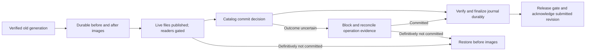

# Coordinated publication — adopted foundation

**Recommendation:** stage new bytes and durable undo copies, then use one committed-operation row in the owning unit's SQLite catalog as the commit decision. This keeps approved category files and one base-folder mapping. It is an application protocol around SQLite, not an assertion that SQLite transactions include arbitrary files. Jo adopted this single-unit foundation through the execution approval on 2026-10-17. TECH-02 remains open for cross-unit operations, concrete platform primitives and failure verification. [Data foundations](data-contracts.md) define proposed shared identities/receipts.

## Trade-off for adoption

| Option | Fit and cost |
|---|---|
| Staged undo journal + catalog commit decision (recommended) | Preserves current ID-named category-file locations. Needs before/after storage, a brief publication gate and verified idempotent undo/redo. |
| Immutable file generations + catalog-selected pointers | Could avoid replacing live files before commit, but requires a different versioned physical-path/current-file contract and explicit cleanup/reference rules. That layout is not adopted by this proposal. |

This choice is about the publication mechanism; it does not reopen JSON/WRT content ownership or make a SQLite-only content store an alternative.

## Boundaries

One operation mutates one owning unit/catalog, potentially several JSON/WRT/managed-asset paths and catalog relationships. The background authority owns the coordinator. No renderer accesses live files directly. All application reads/captures and writers respect the unit publication gate; an already loaded editor can remain responsive while new persistence reads wait. Writer ownership/fencing must be supplied by TECH-04 before implementation. An in-process mutex alone is insufficient for another session.

No atomicity claim spans a project and universe catalog. Do not implement a two-unit mutation as two independent successful single-unit saves. Event creation plus chapter association, recovery activation across units, root relocation with another active session and cross-store history require explicit coordination under TECH-02–09. These are remaining blockers, not permission to drop one side or leave user-visible partial results.

## Durable records

Store operation workspace beneath the owning root's dedicated database area: `database/operations/<operation-id>/`. `database` is a proposed physical name; final registry/adapter mapping still needs adoption. Journal includes schema version, operation/owner IDs, request digest, expected/target generation, expected record versions, fencing token, ordered mutation entries, and hashes/lengths/paths for durable before and staged after bytes. Every changed/deleted path has a complete before image; a new path records previous absence. Freeze and flush the complete journal before changing any live path. Keep both before and after images until recovery can no longer need them. Journal/staged bytes are not complete revisions or protected backups.

Catalog transaction atomically writes updated rows/generation and `committed_operations(operationId, requestDigest, generation, resultDigest, receiptData)`. Durable committed receipt records remain available for retry/restart; their retirement protocol is unresolved, so cleanup must not delete them arbitrarily. Phase labels/cleanup markers help diagnosis but never override catalog commit evidence. Missing/unreadable catalog or conflicting journal evidence means outcome unknown, not rollback.

## Save sequence

1. Acquire/validate the single-unit writer lease and publication gate. Finish older recovery first. Check owning identity, expected generation, expected object versions and request digest. Validate resolved paths/aliases and all resulting domain/reference invariants. Failure here changes no live bytes.
2. Freeze the submitted editor revision. Serialize matching JSON/WRT and immutable asset additions in the operation workspace. Save complete before images, new bytes and journal hashes. Flush files and directory entries through verified host primitives; enough free space is required for both old/new data.
3. Revalidate the lease/fence and unchanged expected catalog generation before exposing replacements. Replace each affected live file from the staged bytes using same-volume replacement; retain after images for restart. Flush each published file and relevant directory entry. Keep readers/capture blocked while paths could disagree with the catalog. A directory flush/platform primitive failure blocks progress.
4. In one catalog transaction, recheck expected generation/versions/fence, update all catalog rows and generation, and insert the committed-operation result. Commit using the verified durable SQLite configuration. This is the proposed decision point. Any ambiguous commit result is resolved by reopening/recovering SQLite and querying the operation row, never by guessing from an exception.
5. Verify committed receipt evidence and all expected live hashes/versions, then durably mark the journal finalized **before** releasing the publication gate or allowing another unit mutation. Acknowledge only the submitted revision. Failure after the commit decision must finish committed publication/recovery, not roll it back. New typing after the frozen revision remains dirty.
6. Reclaim finalized temporary undo/staging only when no restart path needs it. Cleanup failure cannot turn a confirmed committed save into an unsaved navigation discard; retain cleanup work and report its own operation outcome if needed.

The commit transaction must not race a generation change between step 3 and 4; the held authoritative lease/gate and transactional expectation checks are both required. Code allocation, relationship updates and paired chapter publication use this same operation boundary.

## Restart decision table

Recover SQLite first, acquire exclusive authoritative ownership, then reconcile every unfinished workspace **before** opening writable state, captures or cleanup.

| Evidence | Required outcome |
|---|---|
| Valid journal; catalog definitively readable; operation row absent; catalog remains at expected generation | Restore before images/previous absences idempotently, flush and validate old hashes. Then mark aborted and retain retry context. No success receipt. |
| Matching committed row; unfinalized journal; unit still at that target generation | Finish/verify after images and committed catalog state, flush and finalize durably before releasing the gate. Never undo a committed save because finalization/IPC acknowledgment is missing. |
| Finalized journal and matching committed receipt; unit has since advanced through valid later operations | Retire staging only; never replay old after-images over newer files. A retry returns its recorded earlier receipt, not a promise that it is still the latest generation. |
| Commit result uncertain, catalog unavailable, unexpected generation, foreign edits, missing journal bytes or contradictory hashes | Keep all evidence, block writes/captures for the affected unit and report recovery-required/outcome unknown. Do not silently choose old/new, overwrite unexpected files or report success. |
| Fully committed operation retried with same ID and digest | Return same recorded outcome, without allocating another code/version or duplicating side effects. |
| Same operation ID but different request digest | Reject operation-ID conflict, preserving both live state and evidence. |

Undo of a newly created path may remove it only when its current hash matches the operation's after image. Existing unexpected content is an integrity conflict, not disposable staging. Rollback itself can be interrupted; preserve complete before/after images and replay idempotently on the next restart. No safe success is possible if required evidence is missing.

## Capture, moves and cancellation

Revisions, ZIPs and catalog export acquire a consistent capture contract only after pending saves are durably acknowledged and the relevant unit gates are clear. A SQLite snapshot covers database state; it does not alone capture matching external files. Capturing several units/immutable history and exact retained closure remains TECH-03/09/13.

A whole-folder rebind first validates permanent identity, no active unfinished operation and exclusive ownership; compare-and-swap the one base-path binding. Root discovery/relocation and retry across restarts still need their exact TECH-02/04/11 contract. Never rewrite object identities or all relative paths.

Cancel before the commit decision rolls back through the journal. If commit may have happened, determine its outcome first. After confirmed commit, finish publication; do not promise cancellation undid saved work. Existing UI operation-specific cancel/normal-close rules remain binding. No generic Discard option or global unrelated-project lock is added.

## Implementation proof required

Inject interruption before/after journal flush, each live replacement/directory flush, catalog commit, receipt delivery and cleanup; interrupt undo/redo themselves. Exercise full disk, unavailable permissions, removed drive, corrupted/missing staging, duplicate/different retries, concurrent-open lease loss, stale generation, mismatched JSON/WRT and typing after submission. Assert every restart either opens one verified old/new generation or remains blocked preserving evidence; never a mixed acknowledged state. Include code allocation and root-binding cases. Installed file replacement/flush/locking behavior must be verified on all accepted platforms; no such tests ran in this planning task.

SQLite's atomic-commit documentation describes database guarantees and filesystem assumptions, not an application JSON/WRT transaction. Its durability matrix also distinguishes journal/synchronous modes: a candidate WAL+FULL or rollback+EXTRA profile must be verified under TECH-11; do not claim plain FULL is equally durable in every mode. The concrete binding/pragmas/native adapter are not selected by this proposal. [Atomic commit](https://www.sqlite.org/atomiccommit.html), [synchronous settings](https://www.sqlite.org/pragma.html#pragma_synchronous), [online backup](https://www.sqlite.org/backup.html).
